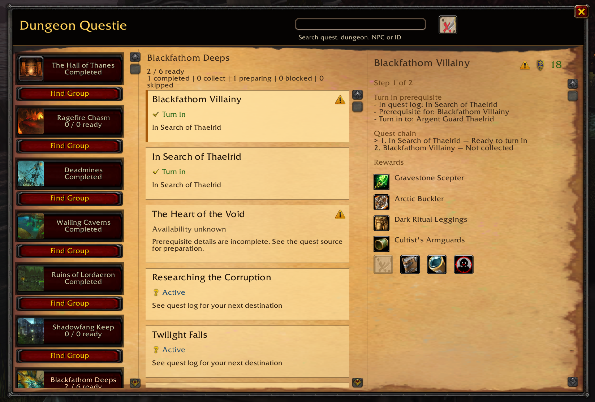

# Dungeon Questie

A simple dungeon-only quest addon for players who prefer a focused checklist
or want a companion to their existing quest addon. Made for **WoW Forever**.

- Pickup directions, rewards and prerequisite steps.
- Progress from your quest log and confirmed turn-ins.
- Map locations for every quest state, with optional TomTom arrows.
- Search by quest, dungeon, NPC or quest ID.
- Find Group buttons and manual whisper/invite controls.

Open with **`/dungeons`**, **`/dgf`**, or the minimap button.

Coverage: **266 quests across 25 dungeon groups**, reviewed 7 November 2026.
Four dungeon groups have no catalogue records. Source details distinguish
Classic references and approximate pins. Empty lists do not mean every quest is done.

## Screenshots

## Quest actions and availability

Green ticks mark actionable steps and dungeon readiness. The readiness tick and ready count mean
the next work can happen during the dungeon run. Reviewed inside pickups count
without inventing an NPC offer. Recorded outdoor prerequisites still block the
chain. Inside hand-ins count; a remaining delivery back to town does not.
Accepted quests with unfinished objectives show Active. Completed quests remain separate.

The 10 November inside-pickup review corrected 13 of 16 flagged records, including
both Gnomeregan ring prerequisite links and inside recipient locations. The older
Glowing Shard variant (3366) and Heart of the Void variants (78916/78917) retain
specific availability/eligibility notes until the game supplies an offer.
Evidence and field changes: `data/inside-readiness-review-2026-11-10.json`.

Uncollected quests show availability unknown until an NPC offer is reported by
`C_GossipInfo.GetAvailableQuests` or `QUEST_DETAIL`. An absent offer at the recorded
NPC shows unavailable for that interaction; closing it clears that evidence.
Optional breadcrumbs show Skipped when their recorded follow-up has progressed;
they are not marked completed. A live offer overrides a reference breadcrumb link.
The bundled links and creature names include Classic reference data, not verified
Forever server availability.

The target icon uses the active step's structured NPC name and a secure
`/targetexact` click (pickup NPC for collection, recipient for turn-in). Missing
NPC records and non-actionable steps disable it. The window closes securely on
combat entry; reopen it afterwards to rescan. Native targeting, range, rendering,
and combat taint still require an in-game check after `/reload`.

## Install

Download the addon ZIP from Releases and extract `DungeonGuideForever` into
`World of Warcraft/_forever_/Interface/AddOns/`. Restart the game if it is
not in the AddOns list. Keep that folder name even though the addon is called
Dungeon Questie.

For WoW Forever Interface **16001**. TomTom and QuestieDB are optional. Questie is not required.

## Map locations

With a compatible Forever QuestieDB installed, missing locations are read from
its public API: quest givers, recipients, item-drop areas, and dungeon approaches.
Existing curated pins take precedence. Dungeon-entrance pins are labelled as
entrances, not exact NPC/objective coordinates. The Drowned City has a separate
guide-sourced approximate underwater entrance pin.

The map button works for unaccepted, active, completed, blocked and skipped
quests. Viewing a location does not assert availability or change readiness.
With map pins enabled, the quests matching the current dungeon/search remain
marked regardless of their preparation or completion status.
Ready-to-hand-in quests prefer recipient pins; active dungeon quests use their
dungeon approach. Active breadcrumbs prefer the recipient. Without QuestieDB,
the bundled curated locations remain available, but full coverage needs the provider.

## Credits

By Videocat. Classic reference records are adapted from
[CMaNGOS Classic-DB](https://github.com/cmangos/classic-db) under GPLv3.
Original addon code retains its MIT licence. Game content belongs to Blizzard.
See [third-party notices](THIRD-PARTY-NOTICES.md) for the complete credits and terms.
This is an independent addon, unaffiliated with the Questie project.

[Data sources and checks](SOURCE-REBUILD.md) · [Walkthrough details](WALKTHROUGHS.md)
· [Maintainer guide](AI-RESEARCH-README.md)
· [7 November review and dependency recommendation](RESEARCH-2026-11-07.md)
