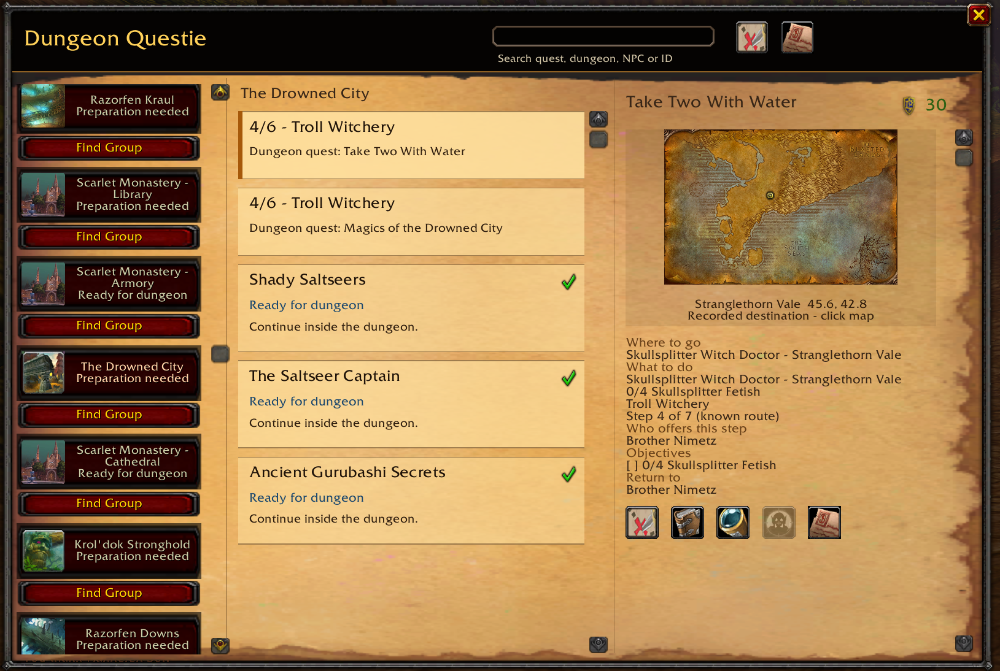

# Dungeon Questie

Requires **QuestieDB**. **Forever Button Controls** is optional.

Version **0.2.8** — 24 November 2026. A focused dungeon quest journal with current-step cards, destination maps, quest chat links and copyable progress exports.

Compact mode opens quests as individual pages with a flat back button. Quest details use original quest-log text or database objective text, with direct destination navigation beneath the map. The journal stays visible during combat; protected updates resume afterward.

Optional [Shortest Path Forever by cjber](https://github.com/cjber/shortest-path-forever) now supplies travel directions. Use the header tracking icon or `/dungeons route` for **Collect Quests — Shortest Route**, and the new map icon or `/dungeons locations` to navigate recorded pickups, objectives, turn-ins, NPC spawns and entrances. TomTom and map-only fallbacks remain. [Controls, planning limitations and in-game checks](NAVIGATION.md).

Scarlet Monastery now has separate Graveyard, Library, Armory and Cathedral
entries, with wing-specific quest lists and Group Finder searches. Recruitment
uses the selected wing's client-suggested levels. Shared quests retain shared
progress. See [wing review](SM-WINGS-2026-11-14.md).

Current location artwork and status changes: [13 November review](ARTWORK-REVIEW-2026-11-13.md). Every selected quest uses the shared current-destination map preview or an explicit unmapped fallback. Unaccepted actions have no completion tick; objectives finished and turned-in quests remain distinct. Coverage gaps and live-client checks are listed in the review.

## 0.2.1 — Forever dungeon review, 13 November 2026

The catalogue now has 320 quest records across all 29 dungeon groups. Drowned
City has eight dungeon quests and two reward handoffs; Krol'dok has 15 records,
Alcaz 15, Blackmaw 11, and Shaper's Terrace six. These counts include faction
variants and related chain stages, not a promise of that many independent quests
for one character. Ruins of Lordaeron launch prerequisites and Unending Torment
continuations were also reviewed. See [the per-quest audit](RESEARCH-2026-11-13.md).

Known faction/class restrictions filter the list. Missing eligibility stays
visible, and temporary requirements remain blocked/preparing. **Data incomplete**
means the guide cannot establish readiness; a real quest offer or acceptance
still takes precedence. QuestieDB 1.1.0 was checked through its public API.
Incomplete routes, missing pickups and source conflicts remain documented.
Saved variables, settings and Classic quest functionality are preserved.

The older coverage notes below describe earlier snapshots, not this version.

A simple dungeon-only quest addon for players who prefer a focused checklist
or want a companion to their existing quest addon. Made for **WoW Forever**.

- Pickup directions, rewards and prerequisite steps.
- Progress from your quest log and confirmed turn-ins.
- Map locations for every quest state, with optional TomTom arrows.
- Search by quest, dungeon, NPC or quest ID.
- Find Group buttons and manual whisper/invite controls.

Open with **`/dungeons`**, **`/dgf`**, or the minimap button.

**Shift-click a quest** to insert its clickable quest link into chat, or use
**Link selected quest in chat** beneath its details. This also works for quests
you have not picked up. If chat is closed, it opens a draft; press Enter to send.
The link refers to the selected quest, including a prerequisite when selected.

Current catalogue: **318 quest records across 32 dungeon groups**. Counts include faction variants and chain stages. Source details distinguish Classic references and approximate pins. Empty lists do not mean every quest is done.

## Screenshots

## Quest actions and availability

Green ticks mark dungeon readiness and can appear alongside gold pickup (!) or turn-in (?) icons. The readiness tick and ready count mean
the next work can happen during the dungeon run. Reviewed inside pickups count
without inventing an NPC offer. Recorded outdoor prerequisites still block the
chain. Inside hand-ins count; a remaining delivery back to town does not.
Accepted quests with unfinished objectives show Active. Completed quests remain separate.

The 10 November inside-pickup review corrected 13 of 16 flagged records, including
both Gnomeregan ring prerequisite links and inside recipient locations. The older
Glowing Shard variant (3366) and Heart of the Void variants (78916/78917) retain
specific availability/eligibility notes until the game supplies an offer.
Evidence and field changes: `data/inside-readiness-review-2026-11-10.json`.

Uncollected quests use recorded level, faction/class/race and prerequisite requirements to show the next pickup without requiring a visit to the quest giver. Specific missing or conflicting requirements remain labelled. Live offers override the guide through
`C_GossipInfo.GetAvailableQuests` or `QUEST_DETAIL`. An absent offer at the recorded
NPC shows unavailable for that interaction; closing it clears that evidence.
Optional breadcrumbs show Skipped when their recorded follow-up has progressed;
they are not marked completed. A live offer overrides a reference breadcrumb link.
The bundled links and creature names include Classic reference data, not verified
Forever server availability.

The target icon uses the active step's structured NPC name and a secure
`/targetexact` click (pickup NPC for collection, recipient for turn-in). Missing
NPC records and non-actionable steps disable it. The window closes securely on
combat entry; reopen it afterwards to rescan. Native targeting, range, rendering,
and combat taint still require an in-game check after `/reload`.

## Install

Download the addon ZIP from Releases and extract `DungeonGuideForever` into
`World of Warcraft/_forever_/Interface/AddOns/`. Restart the game if it is
not in the AddOns list. Keep that folder name even though the addon is called
Dungeon Questie.

For WoW Forever Interface **16001**. **QuestieDB is required; Questie is not required.**
Install and enable the separate Forever version of QuestieDB alongside DungeonGuideForever.
Tested with QuestieDB **1.0.14**, public API contract **4**. TomTom remains optional.
An incompatible provider produces an update message and prevents new readiness claims.

## Map locations

QuestieDB is the main source for available quest levels, objectives, giver and
recipient names, restrictions, prerequisite links, and map locations. Reviewed
local corrections take precedence over provider data; live quest acceptance,
progress and completion take precedence over guide requirements. Unknown minimum
levels display **?**. Reward item IDs, dungeon grouping and useful custom mechanics
remain local; the game supplies item names, icons and tooltips.

Provider locations supersede ordinary fallback pins. Explicitly reviewed local
pins win. Dungeon-entrance pins remain labelled as approaches, not exact NPC or
objective coordinates. The Drowned City keeps its reviewed approximate entrance.

The map button works for unaccepted, active, completed, blocked and skipped
quests. Viewing a location does not assert availability or change readiness.
The world map marks only the destination selected for navigation.
The automatic quest-pin overlay and its toggle have been removed.
Ready-to-hand-in quests prefer recipient pins; active dungeon quests use their
dungeon approach. Active breadcrumbs prefer the recipient. QuestieDB must be enabled even when Questie itself is disabled.

## Credits

By Videocat. Classic reference records are adapted from
[CMaNGOS Classic-DB](https://github.com/cmangos/classic-db) under GPLv3.
Original addon code retains its MIT licence. Game content belongs to Blizzard.
See [third-party notices](THIRD-PARTY-NOTICES.md) for the complete credits and terms.
This is an independent addon, unaffiliated with the Questie project.

[Data sources and checks](SOURCE-REBUILD.md) · [Walkthrough details](WALKTHROUGHS.md)
· [Maintainer guide](AI-RESEARCH-README.md)
· [7 November review and dependency recommendation](RESEARCH-2026-11-07.md)

[Provider integration, precedence, licensing and offline audit](PROVIDER-INTEGRATION.md).

Quest chains show one current-step card, advancing through optional breadcrumbs and preparation to the dungeon quest. Click for current directions; Shift-click links the current quest. Missed breadcrumbs identify a directly active destination to abandon if you want to try recovering the breadcrumb. Progress may be lost and the offer is not guaranteed; completed quests cannot be undone.

## Window controls

Use the **_** button beside Close to minimize to a movable restore bar. Click
**Dungeon Questie +**, the minimap button or `/dungeons` to restore it. Drag the
bottom-right grip to resize the whole journal proportionally; size and position
save per character. Targeting, navigation and group tools leave the journal open.
Use the close or minimize button when you want to hide it. Opening, resizing and targeting remain unavailable in
combat. `/dungeons resetpos` restores the default size and positions.

## Quest supplies before entering

Blueleaf Tubers now shows a **Before you go in** checklist: Crate With Holes,
Snufflenose Command Stick, and a reminder to pick up/read the Snufflenose Owner's
Manual beside Mebok Mizzyrix in Ratchet. Carried bag counts update when bags
change; bank items do not count. Missing crate/stick prevents dungeon-ready
status for the accepted, unfinished quest and routes back toward the quest
supplies. Unknown bag counts remain unknown. The manual's presence does not
prove it was read and is not a required carry check.

This reusable checklist currently covers **Blueleaf Tubers only**. Other quests
can be added after reviewing their actual preparation tools; dungeon drops are
not automatically treated as supplies needed before entering.

Evidence: [Forever quest text](https://wowforevertalents.com/quests/blueleaf-tubers-1221/)
and [Classic item-ID references](https://classicdb.com/?quest=1221), reviewed
16 November 2026. Item IDs/names were also checked in installed QuestieDB 1.1.2.
Offline checks: `uv run --with lupa python tools/check_preparation_items.py`.
Live bag events, readiness display and supply navigation still need an in-game check.

## Automatic quest target indicators

A gold **!** appears beside visible nameplates when the client identifies the unit
as related to an active quest. No targeting or marker selection is required.
These personal indicators do not change shared raid markers. Enable nameplates
in the game to see them. `/dungeons marks` toggles the indicators.

Uses the Forever client's `C_QuestLog.UnitIsRelatedToActiveQuest` and nameplate
APIs. Missing or restricted quest information produces no indicator.
Offline checks: `uv run --with lupa python tools/check_raid_marks.py`.
Live appearance and the client's quest classification still need verification.

Accepting the quest shown on a compact detail page returns to the list when the chain still needs preparation outside the dungeon. Dungeon-ready pickups keep their detail page open; the journal stays visible.

## Ready-player discovery and chat safety

The automatic relaxed-listing offer is disabled following a live client
"Interface action failed because of an AddOn" report on 24 November 2026.
Its experimental module is not loaded by the manifest. Offline mock tests did
not establish permission to call the restricted listing APIs in the live client.
Use the native Group Browser to list yourself; Find Group remains available.

Recruitment, whisper drafts and quest shares use short names for all 32 dungeons
(for example ZF, BRD and SM Lib). Forever-specific dungeons use consistent local
short names; these are not claimed to be universal community standards. Full names
remain in menus and the discovery protocol. Quest shares start with `ZF quests:`
and contain only quest links on continuation messages, still requiring one click per message.

Discovery is enabled by default; turn off **Find ready players** in `/dungeons settings`
to stop its timer, sends and channel membership. Availability and quest readiness gate
advertising. Only solo players and party leaders advertise, with fewer than five
members and outside raids. Non-leaders can listen without advertising.

Each advertiser attempts at most one addon packet per transport (guild and the
DungeonQuestie channel) every 65 seconds, normally 65–70 seconds. Each payload is
at most 160 bytes. Failed joins retry no faster than every five minutes, including
after toggling discovery. Unsupported channel sends stop for the session unless
discovery is explicitly enabled again. There is no visible-chat fallback.

Incoming discovery processing is capped at 30 packets per ten seconds, the peer
cache at 50 players, and peer lifetime at three minutes. Receiving packets never
sends replies or whispers. Local match notices are limited to one
every two minutes. A busy channel can exceed the processing budget, so the list
is best-effort and may omit players. These limits bound addon work, not server
fan-out or the game's own event-delivery cost.

Public recruitment posts and quest shares require clicks. **Auto-invite matching
players** is off by default and stays enabled until unchecked. When on, it attempts
invitations immediately for whisper requests, matching LFG posts in joined
channels/guild/say/yell, and matching solo players received through discovery.
LFM and visibly group-based LFG requests are skipped. Public chat cannot prove
that a sender is solo; the server handles players already grouped elsewhere.
When off, matching only records candidates (subject to the separate chat/discovery
settings). Leadership, combat, party space and pending invitations still gate sends.
Automatic attempts share a five-per-ten-second budget, a five-minute per-name
cooldown and a bounded 100-name cache across sources. There are no timer retries.
Discovery still waits for readiness and only reacts when a peer packet arrives.
Offline recruitment check: `uv run --with lupa python tools/check_instant_invites.py`.

Offline regression coverage: `uv run --with lupa python tools/check_party_discovery.py`.
Live Forever channel support, join/leave notices and performance with many users
still need testing; offline checks do not establish a lag-free release.
